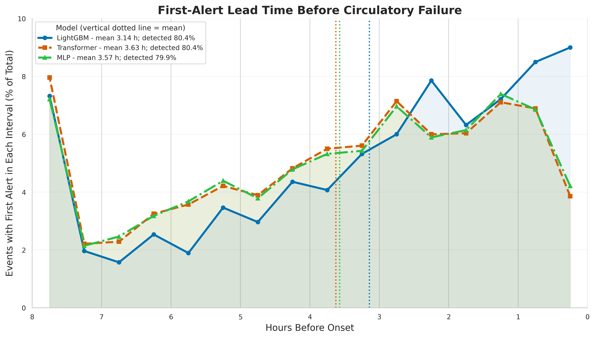

# Results

Only cohort-level aggregate results are included. All performance estimates below are reported at the event/stay level.

## Internal test — MIMIC-IV

| Model       |        AUROC |        AUPRC |       Recall |           F1 |    Precision |
| ----------- | -----------: | -----------: | -----------: | -----------: | -----------: |
| Transformer |     0.929750 |     0.842711 |     0.771071 |     0.768464 |     0.765874 |
| LightGBM    | **0.967538** | **0.917745** | **0.864643** | **0.850369** | **0.836558** |
| FusionMLP   |     0.934700 |     0.857600 |     0.793900 |     0.777100 |     0.761000 |

## External validation — NWICU

| Model       |        AUROC |        AUPRC |       Recall |           F1 |    Precision |
| ----------- | -----------: | -----------: | -----------: | -----------: | -----------: |
| Transformer |     0.903497 |     0.502186 |     0.614627 |     0.542184 |     0.485017 |
| LightGBM    | **0.941556** | **0.618378** | **0.672293** | **0.590123** | **0.525853** |
| FusionMLP   |     0.905472 |     0.487736 |     0.639944 |     0.544584 |     0.473958 |

## External validation — eICU

| Model       |        AUROC |        AUPRC |       Recall |           F1 |    Precision |
| ----------- | -----------: | -----------: | -----------: | -----------: | -----------: |
| Transformer |     0.831886 |     0.360185 |     0.582798 |     0.335303 |     0.235355 |
| LightGBM    | **0.928594** | **0.621163** | **0.849807** | **0.444146** | **0.300636** |
| FusionMLP   |     0.834742 |     0.385051 |     0.622593 |     0.342152 |     0.235895 |

Recall, F1, and precision were calculated using thresholds selected exclusively on the MIMIC-IV validation set and subsequently frozen for internal testing and external validation. No model retraining, scaler refitting, or threshold optimization was performed using NWICU or eICU data.

The results are also available in machine-readable format in `event_metrics.csv`.

## First-alert lead time — MIMIC-IV internal test

This supplementary analysis compares the timing of the first alert at model-specific thresholds selected on the MIMIC-IV validation set to target 80% event recall. The thresholds were applied unchanged to the internal test set. The percentages below are the observed detection rates on that test set, not the validation target.

| Model | Threshold | Events detected / eligible events | Detection rate | Mean lead time (h) | Median lead time (Q1–Q3), h |
| --- | ---: | ---: | ---: | ---: | ---: |
| LightGBM | 0.242733 | 2,250 / 2,800 | 80.4% | 3.14 | 2.58 (1.08–4.67) |
| Transformer | 0.299378 | 2,250 / 2,800 | 80.4% | 3.63 | 3.25 (1.67–5.33) |
| FusionMLP | 0.571429 | 2,236 / 2,800 | 79.9% | 3.57 | 3.17 (1.58–5.33) |

**Figure. First-alert lead time before circulatory failure.** Lead time is the interval from the first alert within the eight-hour prediction window to event onset. Each point is the percentage of all eligible events (2,800) whose first alert fell in that interval. Events without an alert contribute to the denominator but not to any interval. Vertical dotted lines indicate the mean lead time among detected events for each model. The figure labels FusionMLP as MLP.

**LightGBM run.** This analysis uses the `full_primary` LightGBM run. The main performance tables use the `weighted_event_primary` run. The lead times above should not be interpreted as results for the weighted LightGBM model.

[Download the aggregate lead-time results (CSV)](figure_1_lead_time_summary_recall_80.csv).
